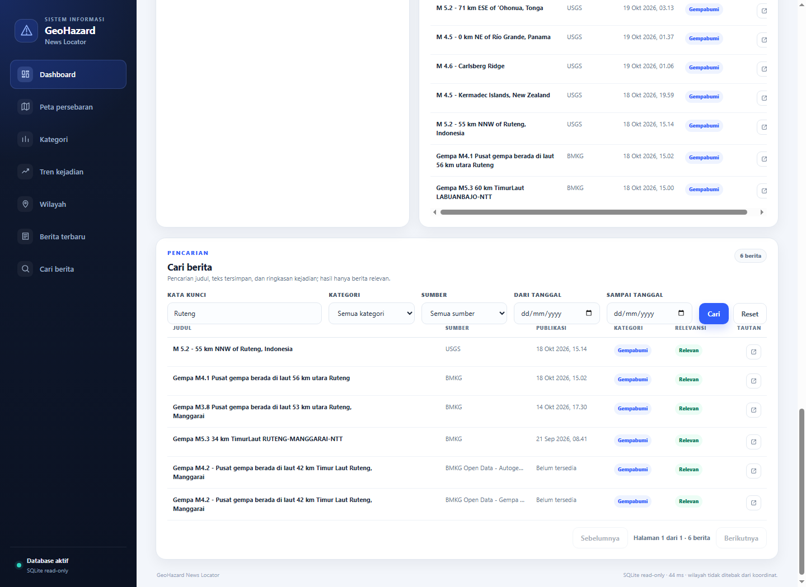
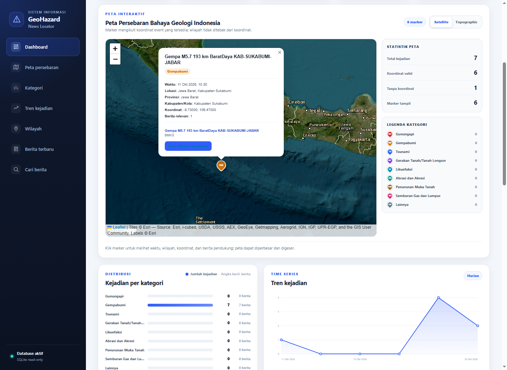
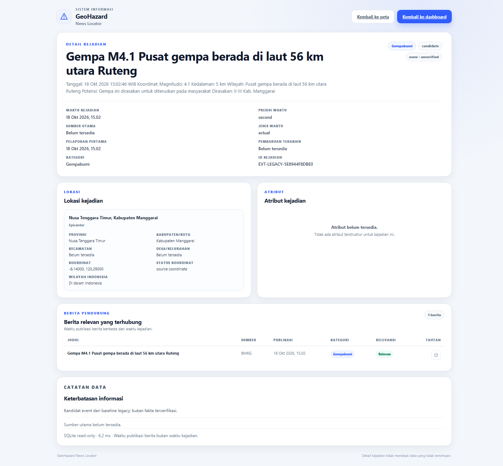
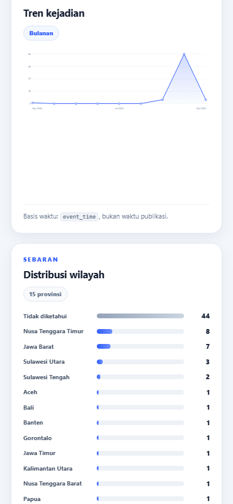
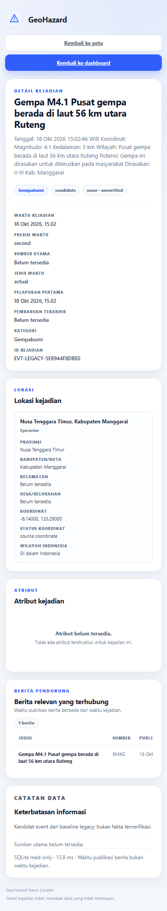

# GeoHazard News Locator

Sistem Informasi dan Pemetaan Persebaran Berita Bahaya Geologi Indonesia.

## 1. Deskripsi dan Tujuan

GeoHazard News Locator adalah proyek yang mengumpulkan, menormalkan, menghubungkan, dan menampilkan berita bahaya geologi Indonesia. Tujuan utamanya adalah menyediakan satu dashboard yang dapat dipakai untuk:

- Melihat ringkasan berita dan kejadian bahaya geologi.
- Menelusuri berita berdasarkan judul, isi berita, dan ringkasan kejadian.
- Memfilter berita berdasarkan kategori, sumber, tanggal publikasi, provinsi, dan kabupaten/kota.
- Melihat persebaran kejadian pada peta.
- Membuka detail kejadian beserta berita pendukung.
- Menjaga jejak asal data (provenance) agar informasi tidak kehilangan konteks sumber.

## 2. Latar Belakang

Berita bahaya geologi tersebar di banyak portal pemerintah, lembaga internasional, dan media. Format, istilah, waktu publikasi, serta tingkat kedetailan setiap sumber berbeda. Kondisi tersebut menyulitkan pencarian, pembandingan, dan pelacakan sumber informasi.

Project ini dikembangkan sebagai pipeline data dan dashboard read-only untuk:

- Menyatukan sumber berita dan kejadian dalam struktur yang konsisten.
- Membedakan waktu kejadian dari waktu publikasi berita.
- Menandai relevansi berita dan kualitas data secara eksplisit.
- Menghubungkan berita pendukung ke kejadian tanpa melakukan merge otomatis.
- Menampilkan data secara transparan, termasuk ketika informasi belum tersedia.

## 3. Fitur Utama

### Dashboard

- Ringkasan jumlah kejadian, dokumen, kategori, dan sumber.
- Daftar berita terbaru yang sudah melalui filter relevansi.
- Filter kategori, tanggal, provinsi, kabupaten/kota, dan granularitas wilayah.
- Indikator kualitas data dan provenance.

### Peta Persebaran

- Peta interaktif berbasis Leaflet dan MarkerCluster.
- Marker kejadian berdasarkan koordinat yang tersedia.
- Filter peta mengikuti filter dashboard.
- Popup marker menampilkan ringkasan dan tautan ke detail kejadian.
- Navigasi kembali dari detail ke peta mempertahankan filter dan anchor `#peta`.

### Pencarian Berita

- Pencarian pada judul berita, catatan dokumen, dan ringkasan kejadian terkait.
- Filter kategori, sumber, dan rentang tanggal publikasi.
- Hanya menampilkan dokumen aktif, relevan, dan tidak ditandai duplikat.
- Pagination, keadaan kosong, keadaan memuat, dan keadaan gagal yang eksplisit.
- Label sumber mengikuti prioritas data yang tersedia.
- Dasar relevansi ditampilkan agar hasil pencarian dapat ditelusuri.

### Detail Kejadian

- Metadata kejadian, waktu kejadian, kategori, status verifikasi, dan sumber utama.
- Lokasi administratif dan koordinat jika tersedia.
- Atribut kejadian seperti magnitudo, kedalaman, dan potensi tsunami.
- Daftar berita pendukung beserta tautan sumber.
- Fallback “Belum tersedia” untuk data yang tidak ada.
- Tautan kembali ke dashboard dan peta dengan filter yang dipertahankan.

### API Read-Only

- `GET /api/dashboard`
- `GET /api/search`
- `GET /api/events/<event_id>`
- `GET /api/health`

## 4. Delapan Kategori Bahaya Geologi

1. Gunungapi
2. Gempabumi
3. Tsunami
4. Gerakan Tanah/Tanah Longsor
5. Likuefaksi
6. Abrasi dan Akresi
7. Penurunan Muka Tanah
8. Semburan Gas dan Lumpur

Dashboard selalu menampilkan delapan kategori tersebut. Ketersediaan data dan sumber utama berbeda untuk setiap kategori. Pada snapshot pengembangan, **Gempabumi** memiliki sumber resmi BMKG yang aktif, sedangkan **Tsunami** hanya tercakup terbatas melalui informasi potensi tsunami pada data gempa BMKG. Enam kategori lainnya belum memiliki sumber utama resmi yang aktif.

## 5. Teknologi yang Digunakan

- Python 3.13 (diuji pada Windows)
- SQLite
- HTTP server dari standard library Python
- HTML, CSS, dan JavaScript tanpa framework frontend
- Leaflet dan Leaflet.markercluster
- pandas
- requests
- feedparser
- BeautifulSoup

## 6. Struktur Folder

```text
GeoHazard-News-Locator/
├─ dashboard/
│  ├─ app.py                 # HTTP server dan endpoint API
│  ├─ repository.py          # Query read-only dashboard, pencarian, detail
│  ├─ templates/             # Halaman dashboard dan detail kejadian
│  └─ static/                # CSS, JavaScript, aset Leaflet
├─ geohazard_pipeline/
│  ├─ fetch.py               # Pengambilan feed
│  ├─ parsers.py             # Parser RSS, Atom, dan BMKG XML
│  ├─ baseline_import.py     # Import baseline legacy
│  ├─ build.py               # Normalisasi dan pembentukan tabel
│  ├─ db.py                  # Utilitas SQLite
│  ├─ runner.py              # Orkestrasi pipeline
│  ├─ schema.py              # Definisi skema
│  └─ util.py                # Utilitas bersama
├─ scraper/                  # Scraper legacy
├─ scripts/                  # Backfill, perbaikan, dan finalisasi data
├─ docs/
│  ├─ screenshots/           # Tangkapan layar aplikasi
│  ├─ final_source_configuration.md
│  ├─ MASTER_SOURCE_REGISTER.csv
│  └─ dokumentasi provenance lainnya
├─ reports/                  # Laporan audit, FIX, dan kualitas data
├─ database/
│  ├─ schema.sql             # Skema SQLite
│  └─ README.md              # Catatan database
├─ data/                     # Tidak disertakan di repository publik
├─ feeds.py                  # Konfigurasi sumber data
├─ run_pipeline.py           # Entry point pipeline
├─ run_dashboard.py          # Entry point dashboard
├─ category_detector.py
├─ location_extractor.py
├─ relevance.py
├─ geographic_scope.py
├─ dataset_baseline.py
├─ import_database.py
└─ test_*.py                 # Test suite project
```

Folder `data/`, database operasional, backup database, file mentah, dan screenshot kerja lokal tidak disertakan di repository publik.

## 7. Dokumentasi Visual

Tangkapan layar berikut berasal dari aplikasi yang benar-benar dijalankan pada snapshot pengembangan.

### Dashboard dan Pencarian



### Integrasi Peta dan Detail Kejadian



### Detail Kejadian



### Tampilan Mobile





## 8. Persyaratan Instalasi

- Windows 10 atau Windows 11.
- Python 3.11 atau lebih baru. Snapshot ini diuji dengan Python 3.13.
- PowerShell.
- Koneksi internet jika ingin mengambil feed dari sumber data.
- Git jika ingin melakukan clone dan pembaruan repository.

## 9. Cara Menjalankan Project di Windows

Dari PowerShell, clone repository dan masuk ke folder project:

```powershell
git clone -b clean-project https://github.com/novalfputa25/GeoHazard-News-Locator.git
cd GeoHazard-News-Locator
```

Buat virtual environment:

```powershell
python -m venv .venv
```

Aktifkan virtual environment:

```powershell
.\.venv\Scripts\Activate.ps1
```

Pasang dependency:

```powershell
python -m pip install --upgrade pip
python -m pip install -r requirements.txt
```

## 10. Cara Menjalankan Dashboard

Database operasional tidak disertakan. Dashboard membutuhkan database SQLite yang sesuai dengan `database/schema.sql` pada path default `database/geohazard.db`, atau path lain yang diberikan melalui opsi `--db`.

Jika ingin membangun database lokal dari pipeline:

```powershell
.\.venv\Scripts\python.exe run_pipeline.py
.\.venv\Scripts\python.exe import_database.py --no-baseline
```

Jalankan dashboard:

```powershell
.\.venv\Scripts\python.exe run_dashboard.py --port 8000 --open
```

Alamat dashboard lokal:

```text
http://127.0.0.1:8000
```

Menggunakan database pada path lain:

```powershell
.\.venv\Scripts\python.exe run_dashboard.py --port 8000 --db path\ke\database.db
```

Hentikan dashboard dengan `Ctrl+C` di terminal.

## 11. Informasi Database

- Database menggunakan SQLite.
- Skema tersedia di `database/schema.sql`.
- Aplikasi membuka database dengan mode read-only dan `PRAGMA query_only = ON`.
- Path default: `database/geohazard.db`.
- Database operasional, backup, dan data mentah tidak disertakan di repository publik.
- Database kerja berisi snapshot data, catatan kualitas, provenance, dan tabel pendukung yang tidak semuanya sesuai untuk dipublikasikan.
- Jangan meng-commit database hasil generate, backup, atau data mentah.

Rincian tambahan tersedia di `database/README.md`.

## 12. Sumber Data

Konfigurasi sumber aktif berada di `feeds.py`. Snapshot pengembangan menggunakan tujuh feed aktif:

| Sumber | Jenis | Peran |
|---|---|---|
| BMKG Autogempa | BMKG XML | Sumber resmi Indonesia |
| BMKG Gempa Terkini | BMKG XML | Sumber resmi Indonesia |
| BMKG Gempa Dirasakan | BMKG XML | Sumber resmi Indonesia |
| USGS M4.5+ | Atom | Sumber internasional pendukung |
| GDACS | RSS | Sumber internasional pendukung |
| ANTARA Warta Bumi | RSS | Berita pendukung |
| Mongabay Indonesia | RSS | Berita pendukung |

Catatan:

- Hanya Gempabumi yang memiliki sumber utama resmi aktif.
- Tsunami hanya tercakup melalui field potensi tsunami pada data BMKG.
- Enam kategori lainnya belum memiliki sumber utama aktif.
- Sumber berita pendukung tidak boleh diperlakukan sebagai sumber resmi kejadian.
- Status lisensi dan redistribusi setiap sumber belum diverifikasi sepenuhnya.
- Dataset mentah dan hasil pipeline tidak disertakan karena alasan lisensi, privasi, dan keamanan data.

## 13. Status Pengembangan Fitur

| Area | Status |
|---|---|
| Pipeline pengumpulan dan normalisasi | Tersedia untuk sumber aktif |
| Import baseline dan SQLite | Tersedia |
| Dashboard ringkasan dan filter | Tersedia |
| Relevansi berita (FIX 07) | Tersedia |
| Filter wilayah (FIX 08) | Tersedia |
| Peta persebaran (FIX 09) | Tersedia |
| Pencarian, pagination, dan detail kejadian (FIX 10) | Tersedia |
| Integrasi peta ke detail kejadian | Tersedia |
| Sumber utama untuk delapan kategori | Belum lengkap |
| Polygon batas wilayah Indonesia | Belum tersedia |
| Verifikasi lisensi/redistribusi seluruh sumber | Belum selesai |
| Test legacy `test_scraper` | Tidak disertakan; API scraper lama sudah berubah |

## 14. Catatan Keterbatasan dan Pengembangan Selanjutnya

### Keterbatasan

- Repository publik tidak menyertakan database operasional, data mentah, CSV hasil pipeline, atau backup.
- Screenshot menampilkan snapshot pengembangan dan bukan database yang disertakan.
- Sebagian besar kategori belum memiliki sumber utama resmi yang aktif.
- Cakupan Tsunami masih terbatas pada informasi potensi tsunami dari data gempa BMKG.
- Sebanyak 20 event pada snapshot pengembangan masih berstatus `tidak_diketahui` karena belum ada polygon batas wilayah Indonesia yang sah.
- Feed BMKG, USGS, dan GDACS adalah jendela data terbatas, bukan arsip lengkap.
- Kategori berita adalah klasifikasi dokumen, bukan bukti kejadian.
- Relasi kandidat antarevent tidak otomatis digabung.
- Lisensi dan syarat redistribusi sumber data belum diverifikasi sepenuhnya.
- Test legacy `test_scraper` tidak disertakan karena mengacu pada API scraper lama yang sudah tidak sesuai.

### Pengembangan Selanjutnya

1. Verifikasi lisensi, atribusi, dan syarat redistribusi seluruh sumber.
2. Tambahkan sumber utama resmi untuk kategori selain Gempabumi.
3. Tambahkan polygon batas wilayah Indonesia yang memiliki dasar dan lisensi yang jelas.
4. Lengkapi materialisasi dokumen pendukung dan audit relasi.
5. Perbaiki atau ganti scraper legacy beserta test-nya.
6. Tambahkan demonstran data sintetis yang aman untuk publikasi.
7. Tambahkan CI untuk test, lint, dan pemeriksaan keamanan repository.
8. Tambahkan dokumentasi deployment jika dashboard akan dipublikasikan sebagai layanan.

## Keamanan Data

- Repository tidak menyertakan `.env`, kredensial, token API, private key, database operasional, backup database, data mentah, atau file sementara.
- File data mentah yang mengandung kontak pihak ketiga tidak diunggah.
- Jalankan pemeriksaan ulang sebelum setiap commit:

```powershell
git status
git diff --cached
git ls-files
```

- Jangan menambahkan file rahasia ke riwayat Git. Jika sebuah secret pernah ter-commit, hapus dari riwayat dan rotasi secret tersebut.
