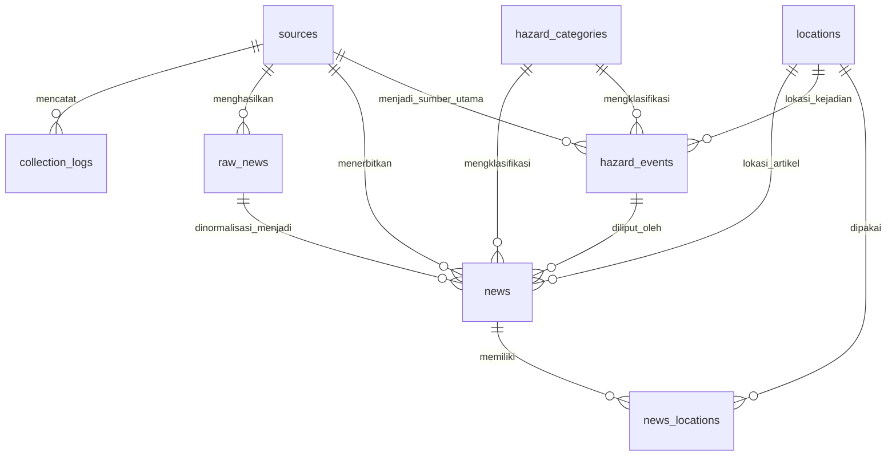
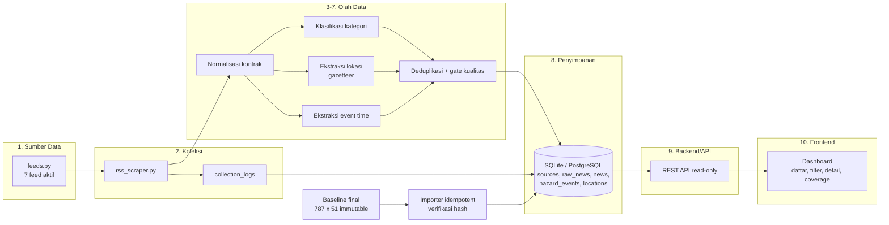

# Audit Kesiapan Arsitektur - GeoHazard News Locator

Tanggal audit: **2026-11-02**  
Mode: **read-only**  
Objek audit: repository, pipeline, struktur data, dan kesiapan arsitektur aplikasi utama  
Basis data: `data/geohazard_news_final_20261101T150501Z.csv`  
Status: **audit selesai; tidak ada implementasi, perubahan kode, database, CSV, atau konfigurasi**

> Audit ini tidak mengulang audit sumber dan tidak mencari sumber baru. Temuan sumber mengacu pada konfigurasi yang sudah ada di `feeds.py` dan `docs/final_source_configuration.md`.

## 1. Ringkasan Proyek

GeoHazard News Locator adalah proyek pengumpulan dan pengayaan berita geohazard Indonesia untuk delapan kategori target: Gunungapi, Gempabumi, Tsunami, Gerakan Tanah/Tanah Longsor, Likuefaksi, Abrasi dan Akresi, Penurunan Muka Tanah, serta Semburan Gas dan Lumpur.

Saat ini repository berisi pipeline batch berbasis Python dan CSV. Belum ada aplikasi utama, database aplikasi, backend/API, atau frontend/dashboard.

Kesimpulan utama:

- **Aplikasi utama: BELUM ADA.**
- **Database: BELUM DIBANGUN.**
- **Backend/API: BELUM DIBANGUN.**
- **Frontend/dashboard: BELUM DIBANGUN.**
- **Dataset final:** siap dipakai sebagai baseline awal, tetapi bukan data operasional tervalidasi.
- **Pipeline:** ada dan dapat menghasilkan dataset, tetapi masih berupa pipeline riset/batch dengan path dan hash hardcoded, belum menjadi pipeline produksi yang dapat dijalankan ulang secara aman tanpa intervensi manual.
- **Kesiapan integrasi:** data siap diimpor ke database sebagai seed; pipeline live belum siap dihubungkan langsung ke aplikasi.

## 2. Struktur Repository

### 2.1 Gambaran direktori

| Path | Isi | Status |
|---|---|---|
| `data/` | 37 artefak: 25 CSV, 7 MD, 4 JSON, 1 HTML | Ada; artefak pipeline dan baseline |
| `scripts/` | 6 script stage/final dan eksperimen V2 | Ada; sebagian legacy/paralel |
| `reports/` | 9 laporan sebelumnya + laporan audit ini | Ada; dokumentasi |
| `docs/` | 1 dokumen konfigurasi sumber final | Ada |
| `scraper/` | `bmkg_scraper.py` | Legacy BMKG |
| `database/` | Kosong | **BELUM DIBANGUN** |
| `static/` | Kosong | **BELUM DIBANGUN** |
| `templates/` | Kosong | **BELUM DIBANGUN** |
| `sources/` | Kosong | **BELUM DIBANGUN** |
| `.venv/` | Virtual environment Python 3.13.15 | Ada; bukan aplikasi |

### 2.2 Modul utama di root

- `rss_scraper.py`: pengumpul RSS/Atom/BMKG XML.
- `category_detector.py`: klasifikasi kategori berbasis aturan.
- `location_extractor.py`: ekstraksi lokasi dan koordinat.
- `feeds.py`: registry sumber dan feed aktif.
- `dataset_baseline.py`: kontrak baseline final.
- `build_gazetteer.py`: pembangun `data/wilayah_gazetteer.json`.
- `clean_data.py`, `scraper/bmkg_scraper.py`, `read_class.py`, `debug_article.py`, `rss_test.py`, `check_dup.py`, `check6.py`, `phase2b_audit2.py`: utilitas/legacy/eksperimen.
- `wilayah_reference.py`: daftar 38 provinsi dan alias.

Tidak ditemukan:

- `requirements.txt`, `pyproject.toml`, `Pipfile`, `poetry.lock`, atau manifest dependency lain.
- `.env` atau konfigurasi kredensial.
- file SQL, migration, ORM, model database, atau file database.
- route/controller, aplikasi Flask/FastAPI/Django, atau kode backend.
- template HTML aplikasi dan aset frontend.
- dokumentasi arsitektur atau API.

### 2.3 Dependency yang terpasang di `.venv`

Python **3.13.15** dengan `pandas 3.0.6`, `numpy`, `requests`, `feedparser`, `beautifulsoup4`, dan `lxml`. Tidak ada framework web, ORM, driver database, atau framework test tambahan di luar `unittest` bawaan Python.

Test yang tersedia: 9 file `test_*.py` yang berfokus pada pipeline, klasifikasi, lokasi, event time, final release, dan baseline. Tidak ada test untuk database, API, atau frontend karena komponen tersebut belum ada. Test tidak dijalankan pada audit ini sesuai batas read-only.

## 3. Kondisi Pipeline Saat Ini

### 3.1 Jalur pipeline final

Jalur yang menghasilkan baseline final:

```text
rss_scraper.py
  -> data/geohazard_news_scrape_<timestamp>.csv
location_extractor.py
  -> data/geohazard_news_located_<timestamp>.csv
scripts/improve_geohazard_quality_stage5.py
  -> data/geohazard_news_located_<timestamp>_stage5.csv
scripts/refine_geohazard_quality_stage5_2.py
  -> data/geohazard_news_located_<timestamp>_stage5_2.csv
scripts/extract_event_time_stage5_4.py
  -> data/geohazard_news_located_<timestamp>_stage5_4.csv
scripts/finalize_geohazard_release.py
  -> data/geohazard_news_final_<timestamp>.csv
```

### 3.2 Karakter pipeline

- `rss_scraper.py` mengambil 7 feed aktif, melakukan klasifikasi awal, dan menulis CSV baru bertimestamp. Output berisi 18 kolom, termasuk `source_id`, `duplicate_of`, dan `duplicate_reason`.
- `location_extractor.py` memilih file `geohazard_news_scrape_*.csv` terbaru. Jika tidak ada, ia fallback ke `data/geohazard_news.csv`. Outputnya menambahkan field lokasi dan koordinat.
- Script stage 5, 5.2, 5.4, dan final memakai path input bertimestamp yang **hardcoded** serta memverifikasi SHA-256 input. Output baru juga bertimestamp.
- `finalize_geohazard_release.py` memetakan kategori di luar cakupan ke `Lainnya`, menormalkan waktu, menandai relasi lokasi, dan menandai duplikat tanpa menghapus baris.
- `category_detector.py` masih memiliki default `data/bmkg_news.csv` dan `data/bmkg_news_classified.csv`, yaitu path pipeline BMKG legacy.
- `scraper/bmkg_scraper.py` dan `clean_data.py` juga memakai `data/bmkg_news.csv`. Keduanya bukan bagian dari jalur final.
- `scripts/build_geohazard_v2_phase1.py` dan `scripts/refine_geohazard_v2_phase1.py` merupakan cabang eksperimen V2 berbasis CSV lama, bukan jalur baseline final.

### 3.3 Kesiapan operasional

Pipeline **belum siap produksi** karena:

- Tidak ada orchestrator atau satu entry point yang menjalankan seluruh urutan stage.
- Input stage final hardcoded ke file historis, sehingga output scrape baru tidak otomatis masuk ke stage berikutnya.
- Tidak ada mekanisme retry, timeout terpusat, rate limit, atau pencatatan run yang konsisten.
- Tidak ada `run_id`, `collected_at`, atau `source_id` yang dipertahankan sampai dataset final.
- Tidak ada penanganan kegagalan parsial yang terikat pada database.
- Validasi masih berbasis CSV dan hash, bukan transaksi database.

Pipeline masih berguna sebagai **batch research pipeline** dan penghasil baseline, tetapi belum menjadi layanan data yang dapat diandalkan aplikasi.

## 4. Struktur Data Final

### 4.1 Identitas baseline

| Atribut | Nilai |
|---|---|
| Path | `data/geohazard_news_final_20261101T150501Z.csv` |
| SHA-256 | `be4fffc3cc7a72b008154e9663153b6bb96545f21420a3aded37209490a3eb06` |
| Baris | 787 |
| Kolom | 51 |
| URL unik | 787 |
| Sumber final | `data/geohazard_news_located_20261101T144531Z_stage5_4.csv` |

`dataset_baseline.py` dan `reports/FINAL_DATASET_BASELINE.md` sudah menetapkan bahwa dataset final tidak boleh diubah. Aplikasi harus membaca `PRIMARY_DATASET_PATH`, bukan CSV lama.

### 4.2 Kelompok kolom

- Identitas dan konten: `judul`, `url`, `sumber`, `isi_berita`, `published_time`, `event_time`.
- Kategori: `kategori`, `kategori_asal`, `kategori_berubah`, `kategori_alasan`, `status_cakupan`, `kategori_sebelum_final`, `kategori_final_aksi`.
- Lokasi: `provinsi`, `kabupaten_kota`, `kecamatan`, `desa_kelurahan`, `dusun_kampung`, `rw`, `rt`, `alamat_detail`, `domain_lokasi`, `domain_lokasi_sebelum`, `domain_lokasi_basis`, `lokasi_verifikasi`, `lokasi_basis`, `lokasi_risiko`, `lokasi_hubungan`, `lokasi_presisi`.
- Koordinat: `latitude`, `longitude`, `koordinat_status`, `koordinat_sumber`, `koordinat_verifikasi`, `koordinat_domain`.
- Waktu: `published_time_mentah`, `published_time_zona`, `published_time_format`, `event_time_status`, `event_time_basis`, `event_time_evidence`, `event_time_jenis`, `event_time_zona`.
- Duplikasi: `duplikat_judul`, `duplikat_url`, `duplikat_dengan`, `duplikat_isi`, `duplikat_kelompok`.
- Catatan kualitas: `catatan_stage5`, `catatan_stage5_2`, `catatan_final`.

### 4.3 Distribusi sumber

Dataset final memuat 16 label sumber:

| Sumber | Baris |
|---|---:|
| detikcom | 100 |
| CNN Indonesia | 100 |
| CNBC Indonesia | 100 |
| Media Indonesia | 100 |
| ANTARA | 97 |
| Tempo | 50 |
| Liputan6 | 50 |
| BMKG | 38 |
| SINDOnews | 30 |
| kumparan | 25 |
| BBC Indonesia | 21 |
| ANTARA Jatim | 20 |
| Mongabay | 20 |
| Republika | 15 |
| USGS | 11 |
| GDACS | 10 |

Konfigurasi saat ini hanya memiliki **7 feed aktif**. Dataset final adalah baseline historis dan memuat sumber yang tidak lagi aktif. Karena dataset final tidak menyimpan `source_id`, tidak dapat dipastikan berapa baris berasal dari masing-masing feed aktif. Ini adalah keterbatasan provenance, bukan temuan sumber baru.

### 4.4 Kualitas data

| Metrik | Kondisi |
|---|---|
| Kategori `Lainnya` | 734 dari 787 baris |
| `tidak_terklasifikasi` | 632 baris |
| `di_luar_8_kategori` | 102 baris |
| `dalam_8_kategori` | 53 baris |
| `event_time` terisi | 64 baris |
| `event_time` tidak diketahui | 723 baris |
| `event_time` aktual / tanggal saja / nowcast | 42 / 13 / 9 |
| Provinsi terisi | 88 baris |
| Kabupaten/kota terisi | 40 baris |
| Kecamatan/desa/dusun/RW/RT terisi | 0 baris |
| Koordinat terisi | 40 baris |
| Relasi lokasi tidak diketahui | 679 baris |
| Duplikat judul / isi / URL | 10 / 4 / 0 baris |

Implikasi:

- Dataset ini **belum layak disebut pemantauan delapan kategori yang lengkap**.
- Peta tidak boleh menjadi tampilan utama pada MVP karena hanya 40 baris memiliki koordinat dan 679 baris tidak memiliki relasi lokasi yang diketahui.
- Status `belum terverifikasi`, `tidak diketahui`, dan `Lainnya` harus ditampilkan apa adanya.
- Dataset siap menjadi **seed database dan baseline evaluasi**, bukan sumber kebenaran operasional.

## 5. Kesiapan Database

Status: **BELUM DIBANGUN.**

`database/` kosong. Tidak ada file SQL, migration, ORM, skema, koneksi, atau database aplikasi.

### 5.1 Arah penyimpanan yang disarankan

- Baseline CSV tetap menjadi **artefak immutable**.
- Database menjadi **salinan layanan** untuk query aplikasi, bukan pengganti baseline.
- Untuk MVP dengan 787 baris dan satu node, **SQLite** adalah pilihan paling aman karena tidak membutuhkan service tambahan dan Python sudah memiliki `sqlite3`.
- PostgreSQL/PostGIS dipertimbangkan setelah kebutuhan multi-user, konkurensi, atau analisis spasial muncul.
- Jangan membuat database atau migration pada audit ini.

### 5.2 Rancangan tabel awal

| Tabel | Field inti | Fungsi |
|---|---|---|
| `sources` | `id`, `nama`, `tipe`, `feed_url`, `aktif`, `cakupan_json`, `status_izin`, `created_at` | Registry sumber dan status izin |
| `hazard_categories` | `id`, `kode`, `nama`, `target`, `urutan` | Delapan kategori target + `Lainnya` + kategori luar cakupan |
| `collection_logs` | `id`, `source_id`, `started_at`, `finished_at`, `status`, `http_status`, `items_fetched`, `items_new`, `error_message` | Jejak eksekusi koleksi |
| `raw_news` | `id`, `source_id`, `external_id`, `url`, `title`, `summary`, `raw_json`, `fetched_at`, `content_hash` | Snapshot mentah dan provenance |
| `news` | `id`, `raw_news_id`, `source_id`, `category_id`, `event_id`, `location_id`, `title`, `url`, `url_hash`, `content`, `published_time`, `event_time`, `event_time_status`, `status_cakupan`, `verification_status`, `duplicate_group`, `is_canonical`, `quality_notes_json`, `dataset_version`, `created_at` | Artikel yang sudah dinormalisasi dan diperkaya |
| `hazard_events` | `id`, `event_key`, `category_id`, `event_time`, `event_time_status`, `latitude`, `longitude`, `location_id`, `primary_source_id`, `verification_status`, `confidence`, `created_at` | Entitas kejadian; satu kejadian dapat memiliki banyak berita |
| `locations` | `id`, `province`, `regency`, `district`, `village`, `detail`, `latitude`, `longitude`, `coordinate_status`, `location_relation`, `precision`, `verification`, `created_at` | Lokasi administratif dan/atau koordinat |
| `news_locations` | `news_id`, `location_id`, `relation`, `precision` | Opsional untuk artikel yang menyebut lebih dari satu lokasi |

### 5.3 Relasi utama



Catatan relasi:

- Satu `raw_news` dapat diproses menjadi satu atau beberapa versi `news`.
- Satu `hazard_events` dapat memiliki banyak `news`.
- `news.event_id` boleh kosong jika kejadian belum dikelompokkan.
- `news.location_id` boleh kosong dan tidak boleh dipaksakan.
- `news_locations` ditambahkan hanya jika kebutuhan multi-lokasi dikonfirmasi.
- Duplikat tidak dihapus; gunakan `duplicate_group`, `is_canonical`, dan status review.

### 5.4 Constraint dan aturan impor

- `sources.id` unik.
- `hazard_categories.kode` unik.
- `raw_news` unik pada kombinasi `(source_id, external_id)` bila external ID tersedia.
- `news.url_hash` unik untuk mencegah impor ganda; perubahan isi artikel ditangani sebagai versi baru, bukan penimpaan diam-diam.
- `hazard_events.event_key` unik.
- Semua waktu disimpan sebagai ISO 8601 UTC.
- Foreign key wajib diaktifkan di SQLite.
- Baseline diimpor dengan verifikasi hash, jumlah baris 787, dan jumlah kolom 51.
- Seluruh baris asli disimpan di `raw_news.raw_json` agar 51 kolom tidak hilang saat normalisasi.
- `source_id` untuk data historis dipetakan dari label `sumber`; jika pemetaan tidak pasti, gunakan source legacy dan tandai `provenance_status = tidak_lengkap`.

### 5.5 Pemetaan data existing ke tabel database

| Kelompok data final | Tabel tujuan | Perlakuan |
|---|---|---|
| Seluruh baris 51 kolom | `raw_news.raw_json` | Disimpan utuh sebagai snapshot baseline |
| `judul`, `url`, `isi_berita`, `published_time` | `raw_news`, `news` | Dinormalisasi dan diberi `url_hash` |
| `sumber` | `sources.nama` | Dipetakan ke sumber existing; provenance historis ditandai jika tidak pasti |
| `source_id` | `news.source_id` | Tidak tersedia di baseline; perlu dipertahankan pada pipeline berikutnya |
| `kategori`, `status_cakupan` | `hazard_categories`, `news.category_id`, `news.status_cakupan` | Kategori dipetakan ke kode target atau `Lainnya`; kategori luar cakupan tetap tercatat |
| `event_time`, `event_time_status`, `event_time_jenis` | `news`, `hazard_events` | `event_time` tidak dipaksakan; event hanya dibuat setelah aturan clustering ditetapkan |
| `provinsi`, `kabupaten_kota`, `kecamatan`, `desa_kelurahan`, `alamat_detail` | `locations`, `news.location_id` | Nullable; tidak semua artikel memiliki lokasi kejadian |
| `latitude`, `longitude`, `koordinat_status`, `koordinat_verifikasi` | `locations` | Hanya dianggap titik kejadian jika status relasi mendukung |
| `domain_lokasi*`, `lokasi_hubungan`, `lokasi_presisi`, `lokasi_verifikasi` | `locations`, `news.quality_notes_json` | Menjadi metadata kualitas dan batas klaim |
| `duplikat_judul`, `duplikat_url`, `duplikat_isi`, `duplikat_kelompok` | `news.duplicate_group`, `news.is_canonical`, `news.quality_notes_json` | Tidak ada penghapusan baris; duplikat hanya ditandai |
| `catatan_stage5`, `catatan_stage5_2`, `catatan_final` | `news.quality_notes_json` | Jejak audit dipertahankan |
| `kategori_sebelum_final`, `kategori_final_aksi` | `news.quality_notes_json`, `hazard_categories` | Menjelaskan perubahan kategori saat finalisasi |

## 6. Kesiapan Backend/API

Status: **BELUM DIBANGUN.**

Tidak ada aplikasi web, route, controller, service layer, autentikasi, atau konfigurasi server. Tidak ada framework web yang terpasang.

### 6.1 API minimum yang disarankan

| Endpoint | Fungsi |
|---|---|
| `GET /api/health` | Status aplikasi dan database |
| `GET /api/sources` | Daftar sumber, status aktif, dan cakupan |
| `GET /api/categories` | Delapan kategori target dan `Lainnya` |
| `GET /api/news` | Daftar berita dengan filter kategori, sumber, provinsi, status, tanggal, dan pencarian |
| `GET /api/news/{id}` | Detail berita dan metadata kualitas |
| `GET /api/events` | Daftar kejadian terkelompok |
| `GET /api/events/{id}` | Detail kejadian dan berita terkait |
| `GET /api/stats/coverage` | Statistik cakupan, jumlah per kategori, dan tingkat kelengkapan |

### 6.2 Prinsip backend

- API read-only pada fase pertama.
- Pagination dan filter wajib; jangan mengembalikan seluruh 787 baris tanpa batas.
- Status kualitas harus menjadi bagian dari response, bukan disembunyikan.
- Tidak ada operasi tulis dari frontend pada MVP.
- Endpoint admin, trigger scraping, dan koreksi data dipisahkan ke fase berikutnya.
- Framework yang disarankan: **Flask + Jinja** untuk MVP karena `templates/` dan `static/` sudah disediakan dan aplikasi dapat berupa monolith sederhana. **FastAPI** menjadi alternatif jika API-first lebih diprioritaskan. Keduanya belum terpasang dan tidak boleh ditambahkan pada audit ini.

## 7. Kesiapan Frontend/Dashboard

Status: **BELUM DIBANGUN.**

`static/` dan `templates/` kosong. Tidak ada HTML aplikasi, CSS, JavaScript, atau aset dashboard.

### 7.1 Tampilan MVP yang disarankan

1. **Ringkasan cakupan**: jumlah berita, jumlah per kategori, jumlah tanpa lokasi, jumlah tanpa event time, dan peringatan bahwa dataset belum lengkap.
2. **Daftar berita**: tabel dengan filter kategori, sumber, provinsi, status verifikasi, dan rentang tanggal.
3. **Detail berita**: judul, sumber, waktu terbit, waktu kejadian, kategori, lokasi, koordinat, status kualitas, dan tautan sumber.
4. **Detail kejadian**: daftar berita yang terkait dan status verifikasi.
5. **Peta**: fase kedua, hanya untuk baris dengan koordinat terverifikasi; peta bukan tampilan utama.

### 7.2 Aturan tampilan

- Tampilkan `Lainnya`, `tidak diketahui`, dan `belum terverifikasi` secara eksplisit.
- Jangan menampilkan koordinat sebagai titik kejadian final jika `lokasi_hubungan` hanya berupa rujukan administratif.
- Jangan memberi kesan bahwa delapan kategori tercakup penuh.
- Jangan menambahkan SPA framework sebelum kebutuhan interaksi terbukti.

## 8. Risiko Teknis

| Risiko | Dampak | Mitigasi |
|---|---|---|
| Tidak ada aplikasi, DB, API, dan frontend | Belum ada produk yang dapat digunakan | Bangun lapisan aplikasi secara bertahap dari baseline |
| Pipeline memakai path dan hash hardcoded | Scrape baru tidak otomatis masuk ke stage final | Ganti dengan konfigurasi/CLI dan orchestrator pada fase pipeline |
| Dataset historis memuat 16 sumber, sedangkan feed aktif 7 | Cakupan data tidak sama dengan cakupan sumber saat ini | Tampilkan provenance dan status sumber; jangan klaim cakupan live |
| `source_id` hilang di dataset final | Tidak dapat melacak feed asal secara presisi | Pertahankan `source_id` pada pipeline berikutnya; tandai data historis sebagai provenance tidak lengkap |
| Tidak ada `collected_at`/`run_id` | Sulit mengaudit kapan dan bagaimana data diperoleh | Tambahkan `collection_logs` dan `run_id` pada pipeline baru |
| Kelas `Lainnya` 734/787 | Dashboard bisa menyesatkan jika dianggap klasifikasi lengkap | Tampilkan status klasifikasi dan prioritaskan review |
| Hanya 40 koordinat dan 88 provinsi | Peta hampir kosong dan rawan salah tafsir | Jadikan daftar/filter sebagai tampilan utama; peta fase kedua |
| `event_time` hanya 64 baris | Timeline kejadian tidak lengkap | Tampilkan `event_time_status`; jangan mengisi dari `published_time` |
| CSV sebagai pseudo-database | Tidak ada constraint, transaksi, indeks, atau konkurensi | Gunakan SQLite/PostgreSQL dengan skema eksplisit |
| Tidak ada manifest dependency | Lingkungan tidak reproducible | Tambahkan `requirements.txt`/lock pada fase implementasi |
| Tidak ada test aplikasi | Regresi API/DB tidak terdeteksi | Tambahkan test importer, API, dan UI setelah komponen dibuat |
| Duplikasi artikel vs kejadian | Satu kejadian dapat terhitung berkali-kali | Pisahkan `news` dan `hazard_events`; gunakan `duplicate_group` |
| Batas izin sumber | Otomatisasi dapat melanggar ketentuan | Pertahankan status izin di tabel `sources`; jangan aktifkan sumber terlarang |

## 9. Rekomendasi Arsitektur

### 9.1 Prinsip

- Baseline tetap immutable.
- Database adalah salinan layanan, bukan pengganti baseline.
- Lapisan aplikasi dibangun terpisah dari pipeline lama.
- Mulai dari baca-saja, lalu tambahkan pipeline live.
- Setiap ketidakpastian data ditampilkan, bukan disembunyikan.
- Tidak menambah dependency sebelum ada keputusan implementasi.

### 9.2 Lapisan arsitektur

| Lapisan | Komponen | Kondisi saat ini |
|---|---|---|
| 1. Data Source | `feeds.py`, 7 feed aktif | Ada; cakupan terbatas |
| 2. Data Collection | `rss_scraper.py`, `collection_logs` | Ada sebagian; logging belum ada |
| 3. Normalization | Kontrak kolom dan pemetaan tipe | Implisit di pipeline; belum terpusat |
| 4. Classification | `category_detector.py` | Ada; kualitas masih rendah |
| 5. Location Extraction | `location_extractor.py`, gazetteer | Ada; data lokasi sangat sparse |
| 6. Event Time Extraction | `extract_event_time_stage5_4.py` | Ada; masih batch |
| 7. Deduplication/Validation | `finalize_geohazard_release.py` | Ada; berbasis CSV |
| 8. Database | SQLite/PostgreSQL | **BELUM DIBANGUN** |
| 9. Backend/API | Flask/FastAPI | **BELUM DIBANGUN** |
| 10. Frontend/Dashboard | Jinja/HTML/CSS/JS | **BELUM DIBANGUN** |

### 9.3 Diagram arsitektur target



Catatan diagram: komponen yang sudah ada adalah `feeds.py`, `rss_scraper.py`, dan modul pengayaan. `collection_logs`, database, importer, API, dan dashboard masih berupa rancangan.

## 10. Tahapan Implementasi

| Tahap | Pekerjaan | Keluaran | Kriteria selesai |
|---|---|---|---|
| 0. Freeze | Tetapkan baseline, kontrak 51 kolom, dan aturan read-only | Dokumen keputusan | Tidak ada perubahan data |
| 1. Fondasi | Siapkan struktur aplikasi, skema SQLite, dan konfigurasi | Skema dan modul kosong | Skema dapat dibuat di database baru |
| 2. Importer baseline | Baca `PRIMARY_DATASET_PATH`, verifikasi hash/baris/kolom, impor idempotent | Database seed 787 baris | Hash tetap sama; impor ulang tidak menggandakan |
| 3. API read-only | Endpoint health, news, events, sources, coverage | API berjalan lokal | Filter, pagination, dan status kualitas bekerja |
| 4. Frontend MVP | Halaman ringkasan, daftar, detail, dan coverage | Dashboard read-only | Tidak ada klaim data yang berlebihan |
| 5. Integrasi pipeline | Konfigurasi input, `run_id`, `source_id`, `collection_logs`, retry | Pipeline dapat dijalankan bertahap | Scrape baru dapat masuk ke DB tanpa edit kode |
| 6. Kualitas dan event | Review klasifikasi, clustering event, validasi koordinat | Peningkatan kualitas bertahap | Perubahan dapat diaudit |
| 7. Operasional | Dependency lock, test API/DB, backup, observability | Rilis terbatas | Ada prosedur rollback dan pemantauan |

Urutan ini sengaja tidak dimulai dari refactor scraper. Perubahan pipeline lebih berisiko daripada membuat database dan importer baru yang hanya membaca baseline.

## 11. Daftar Pekerjaan Berikutnya

Prioritas P0:

1. Tetapkan baseline dan kontrak 51 kolom sebagai sumber seed.
2. Petakan 16 label sumber historis ke `sources`; tandai provenance yang tidak lengkap.
3. Finalkan skema SQLite dan aturan impor idempotent.
4. Buat test importer: hash cocok, 787 baris, 51 kolom, impor ulang tidak menduplikasi.
5. Putuskan framework backend: Flask/Jinja untuk monolith MVP atau FastAPI untuk API-first.

Prioritas P1:

6. Implementasikan importer baseline dan database seed.
7. Implementasikan API read-only dengan filter dan status kualitas.
8. Implementasikan dashboard ringkasan, daftar, dan detail.
9. Tambahkan manifest dependency dan test API setelah implementasi disetujui.
10. Tambahkan `source_id`, `collected_at`, dan `collection_logs` pada pipeline berikutnya.

Prioritas P2:

11. Integrasikan stage pipeline dengan konfigurasi, bukan path hardcoded.
12. Tambahkan clustering `news` ke `hazard_events`.
13. Tambahkan peta hanya untuk koordinat terverifikasi.
14. Perluas cakupan sumber hanya setelah izin dan audit sumber terpisah.

## Keputusan Akhir Audit

1. **Apakah aplikasi utama sudah ada?**  
   **BELUM ADA.** Repository hanya berisi pipeline data, utilitas, test pipeline, dan artefak CSV.

2. **Apakah database sudah ada?**  
   **BELUM DIBANGUN.** Direktori `database/` kosong dan tidak ada skema, migration, ORM, atau file database.

3. **Apakah backend/API sudah ada?**  
   **BELUM DIBANGUN.** Tidak ada framework web, route, controller, atau service API.

4. **Apakah frontend/dashboard sudah ada?**  
   **BELUM DIBANGUN.** `static/` dan `templates/` kosong; tidak ada aset antarmuka.

5. **Apakah pipeline siap dihubungkan ke aplikasi?**  
   **Belum untuk live integration.** Pipeline siap sebagai batch research dan penghasil baseline. Diperlukan importer, database, `source_id`, `run_id`, logging koleksi, dan konfigurasi stage sebelum aplikasi dapat mengandalkannya secara operasional.

6. **Apa langkah implementasi pertama yang paling aman?**  
   Buat skema database baru dan **importer baseline idempotent** yang hanya membaca dataset final, memverifikasi hash/baris/kolom, lalu menulis ke database baru. Jangan mulai dari refactor scraper, perubahan CSV, atau pencarian sumber baru.

> Audit ini berhenti di rekomendasi. Tidak ada implementasi yang dijalankan. Menunggu instruksi berikutnya.
